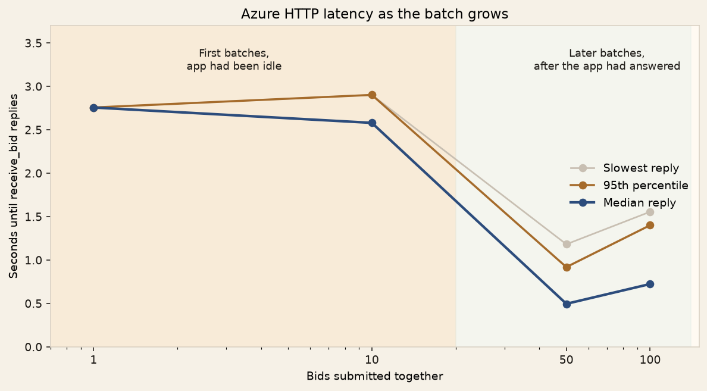
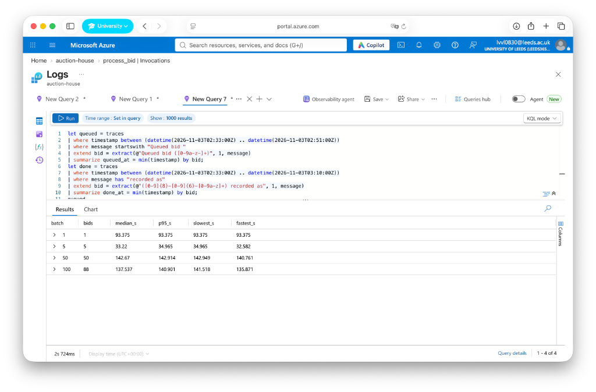
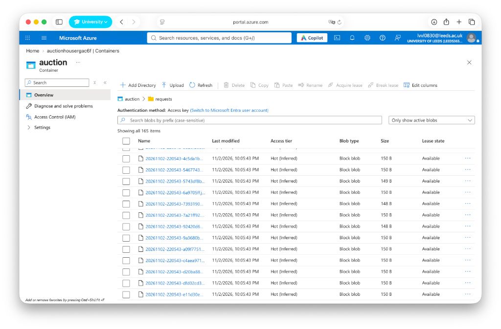
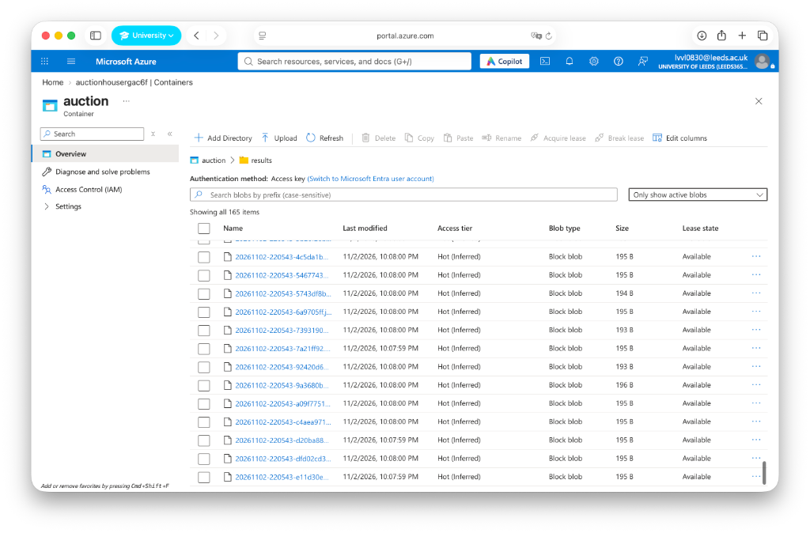
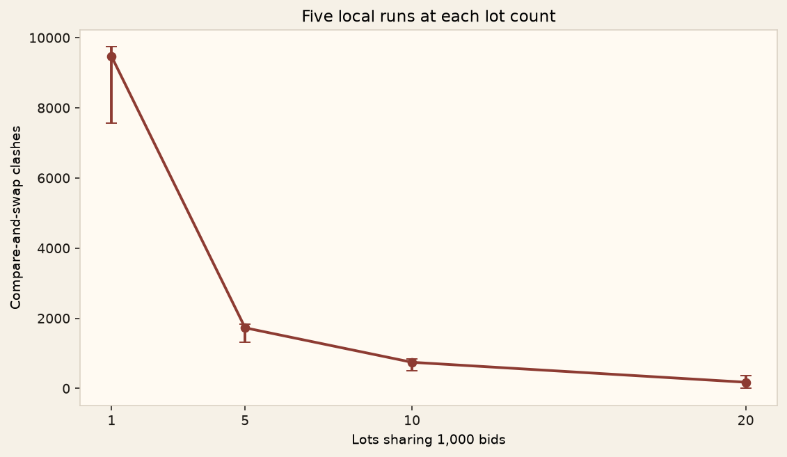

# The Auction House

**A serverless auction experiment in concurrency, consistency and scalability**

**Alisa Lamina** · **Student ID:** 202138390  
**University of Leeds** · **COMP3212 — Resilient Distributed Systems**

What happens when 100 people try to bid on the same object at once? An auction has to accept requests quickly, but it also has to keep one correct price and one leader. I built **The Auction House** to explore that trade-off using Azure Functions, queues and optimistic concurrency.

The project is a small technical prototype, not a commercial auction website. Its lots and bidders are fictional; the problem of concurrent updates is real.


| Lot | Object | Starting price | Minimum increase |
| --- | --- | ---: | ---: |
| 001 | Victorian Pocket Watch — No. 14, still ticking | £120 | £10 |
| 002 | Room With No Door — unsigned oil painting | £500 | £25 |
| 003 | The Travelling Remington — portable typewriter, 1934 | £80 | £5 |

## The problem

Imagine that several bidders see the same current price and submit offers within milliseconds. A system that simply reads the price and writes a new one can lose updates when two requests arrive together. It can also mistake an HTTP acknowledgement for a successful bid.

I wanted to answer three questions:

1. **Consistency:** Can concurrent bids be processed without corrupting the price or recording two leaders?
2. **Responsiveness:** How quickly does the HTTP endpoint accept increasing numbers of bids?
3. **Contention:** What happens when those bids all compete to update the same lot?

The rules are straightforward. A valid bid must meet the current price plus the lot's minimum increase, and it must have arrived before the deadline according to the server clock. A duplicate bid ID must not change the price twice. Both accepted and rejected decisions should be stored for later inspection.

## Business value: where could this system be used?

I did not want to build an auction just to demonstrate three Azure Functions. The practical problem is that an auction organiser needs to accept bids from different people without losing updates or accidentally giving the same lot two leaders. Checking every offer manually might work for a room with a few bidders. It becomes much harder when bids arrive online, especially just before an auction closes.

The Auction House could provide the **bid-processing backend** for a small auction service. For example:

- **Charity or university fundraising auctions:** Participants bid on donated items online. The organiser needs a consistent leading price and a record of accepted and rejected offers.
- **Specialist collectors' auctions:** Several collectors compete for one rare item. Conditional updates prevent two simultaneous requests from overwriting the same price.
- **Event or community auctions:** A website collects bids while the serverless workflow processes them in the background, so the visitor does not have to keep an HTTP connection open while every check runs.

The business value is therefore **reliable bid handling, an inspectable decision history and an HTTP entry point that can acknowledge submissions without waiting for the full workflow**. Serverless infrastructure also allows the application to run without managing a dedicated server.

## Architecture: following a bid


The application runs as **one Azure Function App** with three functions. They do not call one another directly. Instead, each stage leaves a small message in a Storage Queue, which triggers the next stage [1, 2]. The messages contain a bid ID and a pointer to a JSON blob; the actual bid and decision stay in Blob Storage.

| Stage | What happens |
| --- | --- |
| **1. `receive_bid`** · HTTP | Validates `POST /api/bids`, records the server time, saves `requests/<bid_id>.json`, creates the lot file if missing and sends a pointer to `incoming-bids`. |
| **2. `process_bid`** · queue | Reads the request and `lots/<lot_id>.json`, judges the offer and conditionally updates the lot using its ETag. Saves `decisions/<bid_id>.json` and sends a pointer to `bid-results`. |
| **3. `record_result`** · queue | Reads the decision and writes the final outcome to `results/<bid_id>.json`. |

Both queues carry `{"bid_id", "blob"}`. For `incoming-bids`, `blob` points to `requests/<bid_id>.json`; for `bid-results`, it points to `decisions/<bid_id>.json`. All four paths are in the `auction` Blob container.

Here is an example request:

```json
{
  "lot_id": "001",
  "bidder": "Bob",
  "amount": 180,
  "seen_price": 120
}
```

`seen_price` records what the bidder believed the price was. It helps distinguish an offer that was too low from one that became insufficient while waiting. The HTTP reply, `Queued bid <id>`, confirms **submission**, not acceptance or victory.

### Keeping the price consistent

The difficult part is the shared lot file. `process_bid` reads the lot and its ETag, then tries to write an updated version **only if the ETag still matches**. If another invocation changed the lot first, the conditional write fails; the function rereads the latest state and judges the bid again [3, 5]. Two competing writes cannot both succeed against the same version.

This implementation tries the conditional write up to **12 times within one invocation**. If those attempts fail, the invocation raises an error and the queue can redeliver the message. The lot also records previously judged bid IDs. If a retry finds the bid already applied, it reuses the stored decision instead of raising the price again, then continues towards the result file. `record_result` writes to a deterministic path, so repeated deliveries overwrite the same result. This is **idempotent processing under at-least-once delivery**, not exactly-once execution.

I used **Python** for the Azure functions, the HTTP workload generator and the local experiments. Azure Functions supports Python, and using the same language made it easier to share the bid rules between the cloud application and the local model [4]. Matplotlib produces the graphs.

## Testing the system

I tested the deployed workflow on Azure and used a separate in-memory laptop model to explore larger workloads. These are different experiments and should not be treated as equivalent. **Each workload was run once**, so the figures describe these runs rather than stable averages.

### 1. Does the workflow work?

First I submitted **Bob's £180 bid** for the pocket watch. Azure returned `Queued bid 20261102-215819-687f02c7`. After the queue-triggered functions ran, the lot showed Bob as leader at £180, version 1, and the corresponding result blob recorded an accepted bid.

Next I sent three offers for the painting:

| Bidder | Offer | Price when judged | Outcome |
| --- | ---: | --- | --- |
| Alice | £550 | £500 | Accepted |
| Bob | £650 | £550, Alice leading | Accepted |
| Charlie | £600 | £650, Bob leading | Outbid |

Charlie's offer would have beaten the opening price, but not Bob's new bid. The painting ended at **£650, with Bob as its only leader and lot version 3**.


### 2. How quickly does Azure accept more bids?

I submitted batches of **1, 10, 50 and 100 concurrent HTTP requests**, all for the typewriter (lot 003). A Python script used one worker thread per bid. Each batch began after the previous batch's HTTP responses had returned. The offers were generated using `80 + 5 * ((i % 40) + 1)` pounds, with `seen_price` set to £80; amounts therefore repeated.

| Concurrent requests | Batch duration | Median HTTP response | 95th percentile | Slowest | HTTP failures |
| ---: | ---: | ---: | ---: | ---: | ---: |
| 1 | 2.757 s | 2.756 s | 2.756 s | 2.756 s | 0 |
| 10 | 2.920 s | 2.579 s | 2.901 s | 2.901 s | 0 |
| 50 | 1.193 s | 0.495 s | 0.918 s | 1.181 s | 0 |
| 100 | 1.580 s | 0.723 s | 1.400 s | 1.555 s | 0 |

**All 161 HTTP requests were acknowledged.** The first batches took around three seconds. Those were the first calls after the app had been idle, so an idle start may have contributed, but I did not run a separate cold-start trial. The batches of 50 and 100 were sent after the app had already answered, and the median reply fell below one second. At 100 concurrent bids, the median reply took **0.723 seconds**.



This graph is only the time until `receive_bid` responds. It does **not** mean the bid has finished processing.

### 3. How long did the asynchronous workflow take?

To look beyond HTTP responses, I matched the `Queued bid <id>` trace from `receive_bid` with the `<id> recorded as ...` trace from `record_result` in Application Insights. For the **164 bids with both log messages** between 21:00 and 23:00 UTC:

| Matched bids | Median log-to-log interval | 95th percentile | Fastest | Slowest |
| ---: | ---: | ---: | ---: | ---: |
| 164 | **138.6 s** | 140.3 s | 3.2 s | 143.6 s |


This was the biggest surprise of the project. The HTTP endpoint could acknowledge a burst quickly, while the same bids took much longer to reach the final recording stage. The **138.6-second median** was dominated by the typewriter rush: many queue-triggered invocations were competing to update `lots/003.json`. The interval starts at the application's queueing log, not at the client's initial request, and it is not a benchmark of an idle auction.

I then repeated the measurement in separated batches, so each size could be timed on its own. Every HTTP call was accepted: 1, 5, 10, 20, 50, and 100. The log join did not return a row for 10 or for 20, and it matched 88 of the 100. The batches that did match are below.

| Bids sent together | Matched in the logs | Median | 95th percentile | Slowest | Fastest |
| ---: | ---: | ---: | ---: | ---: | ---: |
| 1 | 1 | 93.4 s | 93.4 s | 93.4 s | 93.4 s |
| 5 | 5 | 33.2 s | 35.0 s | 35.0 s | 32.6 s |
| 50 | 50 | 142.7 s | 142.9 s | 142.9 s | 140.8 s |
| 100 | 88 | 137.5 s | 140.9 s | 141.5 s | 135.9 s |



These are not four clean measurements of an idle app. A send of 1,000 bids across the three lots had just finished its HTTP calls when the single bid went out, so that bid waited behind work that was already in the queues. That is why one bid took 93 seconds. The batches of 50 and 100 again sit near 140 seconds, the same band as the first typewriter rush. The missing rows for 10 and 20 are logs that did not join, not a claim that those bids were lost.

### 4. Why were there failed Azure invocations?

Azure showed **126 successful and 106 failed `process_bid` invocations** during the busy period. I investigated the errors rather than assuming they meant 106 lost bids.

One failed trace, operation `220fa7360049694cf375980460819b42`, showed a message already on `DequeueCount: 2`, repeated **HTTP 412** responses when trying to update the lot, and then a `Gave up` message followed by a failed invocation after 2,708 ms. That pattern is consistent with exhausting the 12 conditional-write attempts. The earlier **409** in that trace was the already-existing container, not the failed lot update.


I also found a bid ID from a failed attempt later recorded as outbid in the lot file. This demonstrates recovery for that example: a failed **invocation** did not necessarily mean a missing **bid**. I inspected five failed traces in detail and one full trace, not all 106, so I cannot claim every failure had exactly the same cause.

After processing, `lots/003.json` had **version 161**. Seven typewriter bids were accepted, moving the price from £80 to £280; the other 154 were recorded as outbid. The final leader was `bidder-79` at £280. The versions across all three lots were **1 + 3 + 161 = 165**, matching the 165 accepted HTTP submissions across the single-bid, three-bid and scalability checks.


Both queues were empty when checked and no poison queue was visible. The portal showed 164 successful `record_result` invocations and no errors in that sampled view. I then opened the blob folders. `requests/` and `results/` each contain 165 files, so every bid that `receive_bid` accepted in that workload has a result file.





## What I learned

The system exposed a trade-off I did not see from HTTP timings alone: **accepting work quickly is different from completing it quickly**. Queues let the HTTP function return without waiting, while ETags prevent conflicting lot updates. But when many bids target one file, the retries become a bottleneck.

One possible improvement would be **one writer per lot**, which could reduce ETag conflicts by serialising updates to each lot. Another would be changing the retry strategy. Neither change was deployed or benchmarked, so I cannot claim a measured speed-up. Even with one writer, bids on a popular lot would still have to wait their turn.

## Going further

I also ran 1,000 bids on my laptop. I did this to ask a question the Azure batches do not answer: if the same offers are aimed at one shared record, or spread across many records, how many compare-and-swap clashes appear?

I did not send those 1,000 bids to Azure. At 100 bids on lot 003, `process_bid` was already failing attempts with `412` and the queue was retrying them. A message that fails five deliveries is moved to the poison queue and is not written. A thousand bids on one lot could cross that line, and some bids could be lost. The other half of the test cannot be deployed either. `receive_bid` only accepts lots `001`, `002` and `003`, while the spread case uses 20 lots. The laptop clock also stops when the in-memory function returns. It does not include Azure queue delay, so these times are not Azure times.

`scripts/make_figures.py` uses the same bid rules and an in-memory compare-and-swap, up to 32 threads, seed 7, and a maximum of **80 attempts per bid**. That cap is not the deployed cap of 12. Each size was run once.


| Bids | One lot: time | One lot: clashes | One lot: abandoned | 20 lots: time | 20 lots: clashes |
| ---: | ---: | ---: | ---: | ---: | ---: |
| 10 | 0.003 s | 9 | 0 | 0.001 s | 0 |
| 50 | 0.005 s | 0 | 0 | 0.002 s | 0 |
| 100 | 0.019 s | 0 | 0 | 0.004 s | 0 |
| 500 | 0.914 s | 511 | 0 | 0.030 s | 0 |
| 1,000 | **15.072 s** | **8,052** | **81** | **0.127 s** | **265** |


At 1,000 bids, one lot produced **8,052 failed compare-and-swap attempts** and **81 abandoned bids**. Twenty lots produced **265 clashes** and no abandoned bids. On the single lot, three bids were accepted, 916 were rejected as outbid, and the stored price reached the highest offer, £520. The pattern matches the Azure rush in one respect: the cost follows how many writers share a record, not only how many bids exist. The zeros at 50 and 100 bids are single runs. They are not a curve.

I then kept the number of bids fixed at 1,000 and varied the number of lots: 1, 5, 10, and 20. Each setting was run five times, with seeds 7 to 11. The bars on the graph are the lowest and highest clash counts in those five runs.



| Lots | Median time | Time range | Median clashes | Clash range | Median abandoned |
| ---: | ---: | --- | ---: | --- | ---: |
| 1 | 16.75 s | 14.69–18.90 s | 9,462 | 7,563–9,737 | 87 |
| 5 | 0.98 s | 0.84–1.05 s | 1,728 | 1,324–1,832 | 0 |
| 10 | 0.32 s | 0.32–0.38 s | 745 | 503–850 | 0 |
| 20 | 0.11 s | 0.08–0.14 s | 176 | 4–358 | 0 |

One lot is slow in every run, and it is the only setting that abandons bids. From 5 lots upward, no run abandoned a bid. The clash count at 20 lots still jumps between runs, from 4 to 358, so I do not treat one 20-lot number as exact. The direction is stable: more lots, fewer clashes, less time. `scripts/check_invariants.py` also checks the rules on the laptop: the price does not fall, a repeated bid id is applied once, a stale version does not overwrite a newer one, a late bid is not the leader, and concurrent bids leave one leader. Five checks passed. Those checks are not a count of the Azure result files.

### Limits of this evaluation

- The objects and bids are fictional; there are no accounts, payments or production auction guarantees.
- Azure was tested with up to **100 concurrent HTTP submissions**, once per batch. The first two batches were sent while the app was idle; I did not run a separate cold-start trial. The **1,000-bid** model under Going further uses a different retry cap and does not include Azure queue time.
- The **138.6-second** median measures two application log events for 164 matched bids, not client-to-result latency for every request.
- The portal uses telemetry sampling. I investigated selected failures, not every error, and did not verify all 165 final result blobs.
- The first local graphs are single runs. The later table repeats 1,000 bids five times. Clash counts still move between runs, especially at 20 lots.

## A closer look at the bidding rules

For a small, readable example, the pocket watch starts at £120. In the order **Alice £150 → Bob £180 → Charlie £160**, Alice and Bob are accepted and Charlie is outbid. Changing the order to **Charlie → Alice → Bob** changes which bids are accepted, but Bob still ends at £180. Replaying Bob's bid ID does not raise the price twice. The step-by-step tables are in [the pocket-watch walkthrough](walkthrough/pocket_watch.md).


I also tested the deadline rules locally with simulated server timestamps. Mina, Owen and Priya bid before **18:00:00 UTC on 3 November 2026** and were accepted; Sam and Noor bid after the deadline and were rejected as late, even though their offers were higher. This was **not a live Azure test at those timestamps**.


## Project files and environment

```text
auction-house/
├── function_app.py          # receive_bid, process_bid, record_result
├── auction.py               # bid rules and local compare-and-swap
├── host.json                # Functions host and telemetry sampling
├── requirements.txt         # Azure dependencies
├── local.settings.json.example
├── scripts/make_figures.py  # local experiments and charts
├── figures/                 # architecture, charts and Azure evidence
├── results/                 # experiment CSVs
└── walkthrough/             # step-by-step bidding examples
```

The three functions are deployed together in the `auction-house` Function App (Linux, Flex Consumption, 2048 MB) in **Switzerland North**, resource group `auction-house-rg`. The Storage account is `auctionhousergac6f`; the Blob container is `auction`. The configured deadline was **3 November 2026, 18:00 UTC**. The default queue dequeue limit was five, and `host.json` enabled telemetry sampling except for HTTP requests.

The HTTP endpoint used for the experiments was:

`https://auction-house-b2fjhsc3gneda8cw.switzerlandnorth-01.azurewebsites.net/api/bids`

To regenerate the local figures in an environment with Matplotlib installed:

```bash
python3 scripts/make_figures.py
```

The source code is in [`function_app.py`](function_app.py) and [`auction.py`](auction.py). Experiment tables are in [`results/`](results/), and additional Azure screenshots are in [`figures/`](figures/).

## References

[1] Microsoft, [Azure Functions overview](https://learn.microsoft.com/en-us/azure/azure-functions/functions-overview).

[2] Microsoft, [Azure Queue storage trigger for Azure Functions](https://learn.microsoft.com/en-us/azure/azure-functions/functions-bindings-storage-queue-trigger).

[3] Microsoft, [Managing concurrency in Blob Storage](https://learn.microsoft.com/en-us/azure/storage/blobs/concurrency-manage).

[4] Microsoft, [Azure Functions Python developer guide](https://learn.microsoft.com/en-us/azure/azure-functions/functions-reference-python).

[5] H. T. Kung and J. T. Robinson (1981), “On optimistic methods for concurrency control,” *ACM Transactions on Database Systems*, 6(2), 213–226.
