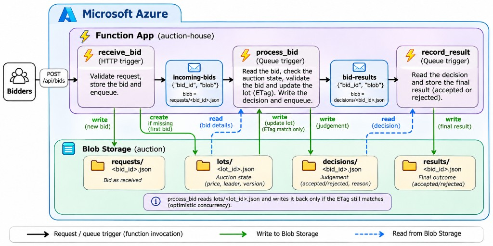
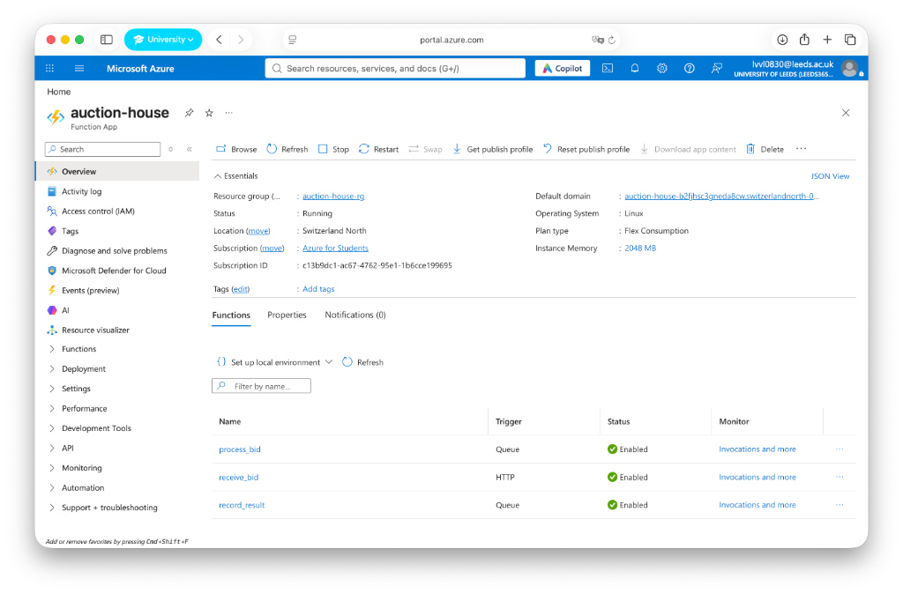
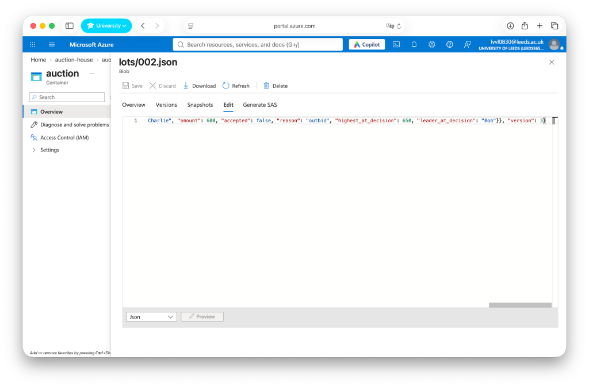
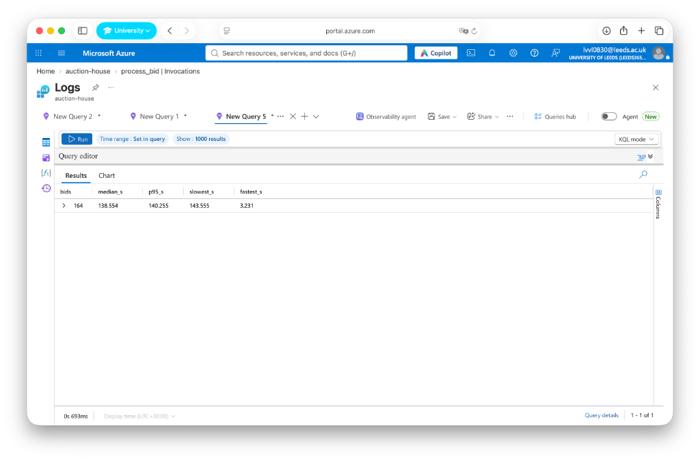
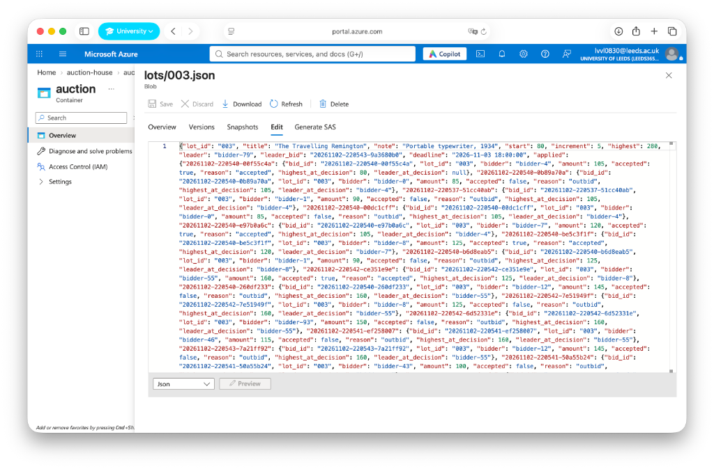
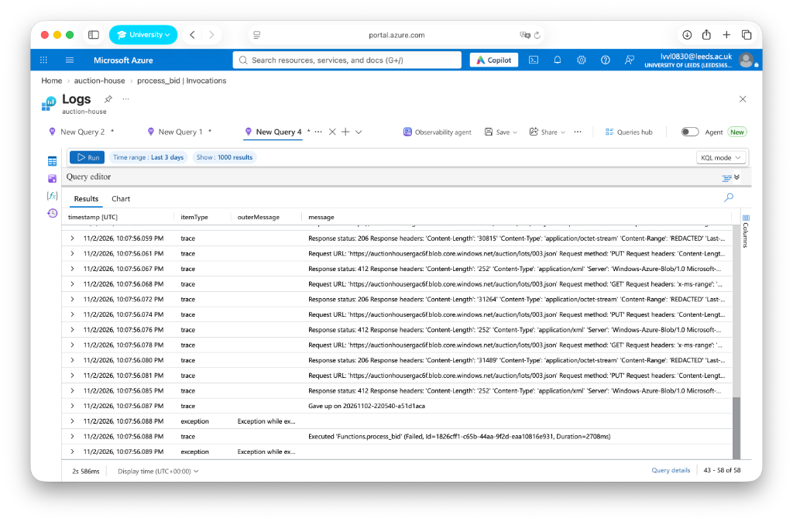
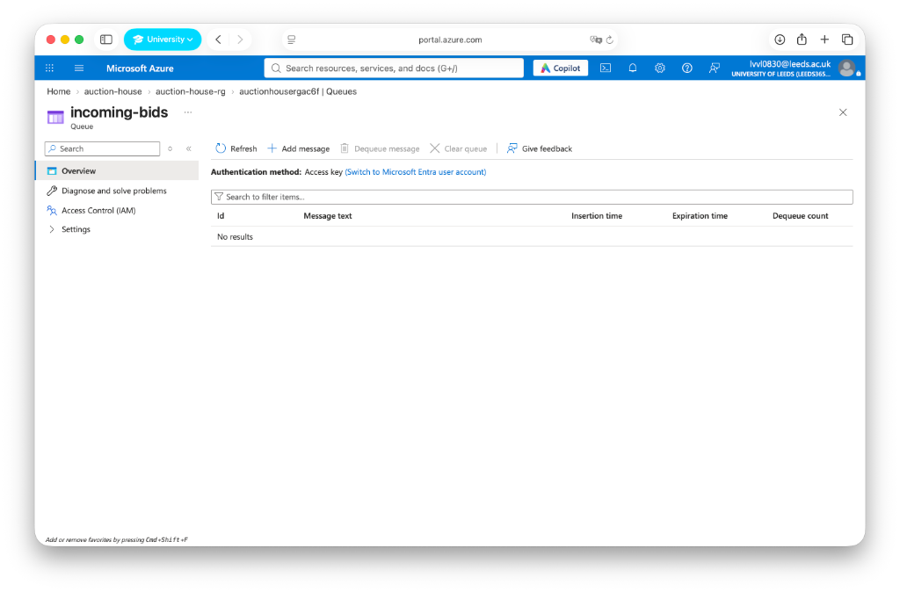
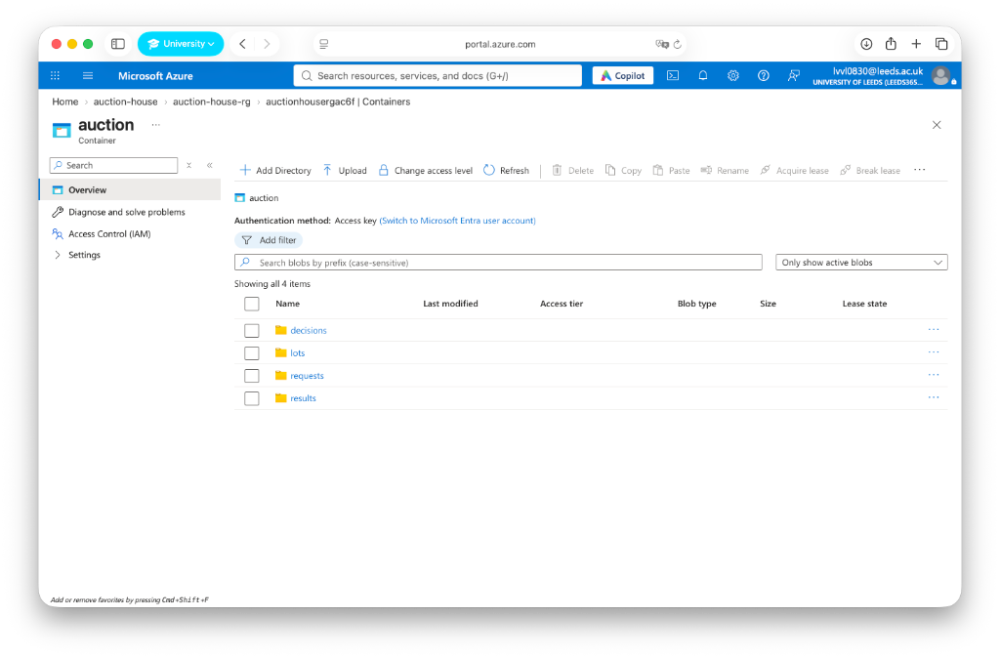

# The Auction House

## Repository

The function files stay in this folder because Azure deploys the folder as one Function App. Pictures, scripts, and the walkthrough are not part of that deploy.

```text
auction-house/
├── function_app.py          receive_bid, process_bid, record_result
├── auction.py               the price rules and the compare-and-swap
├── host.json                the Functions host, including telemetry sampling
├── requirements.txt         the Azure libraries the deploy installs
├── local.settings.json.example
├── scripts/make_figures.py  the laptop batches and the pictures
├── figures/                 architecture, lots, graphs, portal screenshots
├── results/                 the csv tables behind the graphs
└── walkthrough/             Alice, Bob, and Charlie, in two orders
```

| File | What it is |
| --- | --- |
| [function_app.py](function_app.py) | The three Azure functions. |
| [auction.py](auction.py) | Judging a bid, and the in-memory version check used on the laptop. |
| [scripts/make_figures.py](scripts/make_figures.py) | Runs the local batches and writes the pictures. |
| [figures/architecture.jpg](figures/architecture.jpg) | The deployed path: functions, queues, and blob files. |
| [figures/](figures/) | Lots, the local graphs, and the portal screenshots. |
| [results/](results/) | The csv tables behind the local graphs and the Azure HTTP table. |
| [walkthrough/pocket_watch.md](walkthrough/pocket_watch.md) | The two orders of Alice, Bob, and Charlie. |

To draw the local pictures again, from a laptop environment that has matplotlib:

```bash
python3 scripts/make_figures.py
```

## The idea

I built a small auction for three fictional objects.

| Lot | Object | Opens at | Minimum rise |
| --- | --- | --- | --- |
| 001 | Victorian Pocket Watch, no. 14, still ticking | £120 | £10 |
| 002 | Room With No Door, oil, unsigned | £500 | £25 |
| 003 | The Travelling Remington, 1934 | £80 | £5 |


The objects are made up. The problem is not. Several people try to change the same price at nearly the same moment. The house has to reject a bid that is too low, reject a bid that the server received after the deadline, and still finish with one leader. Two bidders must not both be stored as the winner.

The question I investigated is how a larger number of concurrent bids changes three things: whether the stored price stays consistent, how fast the HTTP entry point answers, and how much contention appears when every bid targets one lot.

That is the situation in a last-second rush on one object. The same arrangement applies anywhere many writers must update one shared record, such as the current high bid, without declaring two winners. It is not a shop. There are no accounts and no payments. The useful part is the shared price.

What has to stay true:

- A bid below the current price plus the minimum rise is rejected.
- The deadline uses the server time, not the clock on the bidder's laptop.
- Concurrent updates cannot both succeed against the same lot version. The write carries the version just read. If that version has moved, the write fails, the lot is read again, and the bid is judged against the new price [3], [5].
- One lot has one leader and one highest bid.
- A second delivery of the same bid id does not raise the price twice.
- Accepted and rejected bids can be read back afterwards.

## How it was built

### Architecture



The functions do not call each other. A queue trigger starts the next one [1], [2]. Each queue message is `{"bid_id", "blob"}`. The bid and the decision stay in blob storage.

| Place | What is stored |
| --- | --- |
| `auction/requests/<bid_id>.json` | The bid `receive_bid` accepted for checking. |
| Queue `incoming-bids` | `{"bid_id", "blob"}`, with `blob` set to `requests/<bid_id>.json`. This starts `process_bid`. |
| `auction/lots/<lot_id>.json` | The price, the leader, the version, and the bids already judged. |
| `auction/decisions/<bid_id>.json` | The judgement `process_bid` saved for the next function. |
| Queue `bid-results` | `{"bid_id", "blob"}`, with `blob` set to `decisions/<bid_id>.json`. This starts `record_result`. |
| `auction/results/<bid_id>.json` | The final accepted or rejected outcome. |

**receive_bid** is the HTTP function, `POST /api/bids`. It checks `lot_id`, `bidder`, and `amount`, stamps the bid with the server time, writes `requests/<bid_id>.json`, and queues the pointer. On the first bid for a lot it also creates `lots/<lot_id>.json`. The reply is `Queued bid <id>`. That reply does not mean the bid won.

```json
{
  "lot_id": "001",
  "bidder": "Bob",
  "amount": 180,
  "seen_price": 120
}
```

`seen_price` is the price the bidder thought was current. I use it only to separate a bid that was too low at the start from a bid that was outbid while it waited.

**process_bid** is triggered by `incoming-bids`. It reads the request file, then reads the lot and its ETag. If this bid id is already on the lot, it keeps that decision and does not change the price. Otherwise it judges the bid and writes the lot back only if the ETag still matches. A clash raises `ResourceModifiedError`. On Azure, one invocation tries that write up to 12 times. If all 12 lose, the invocation raises `RuntimeError: Could not record bid <bid_id>`, and the queue delivers the message again as a new invocation. A clash caught inside the 12 attempts does not, by itself, make the portal row red. After a successful write, or after finding that the bid was already applied, the function writes `decisions/<bid_id>.json` and queues the pointer. If it stops after the price write and before that send, the retry still sends the stored decision. The price is not raised a second time.

**record_result** is triggered by `bid-results`. It reads the decision file and writes `results/<bid_id>.json`. A repeat delivery overwrites that same path. That is at-least-once execution with an idempotent file, not a proof that the function ran exactly once.

### Decisions

I used Python for the functions and for the program that sends the bids. Azure Functions runs Python 3 as a supported worker, so the same language is deployed and used to generate the workload [4]. The HTTP calls need only the standard library. Matplotlib, on the laptop, draws the figures.

I split the work into three functions because accepting a bid, judging it against a shared price, and storing the outcome are different steps. The HTTP function returns before the price has moved. The queue, not a direct call, starts the next function, so a failure in one step can be retried without the caller holding the connection [2]. The queue carries a pointer because the bid and the lot are larger than a signal, and the files can be read again.

The lot write uses the ETag so two updates cannot both succeed against one version [3]. I chose a cap of 12 attempts inside one Azure invocation, then let the queue deliver the message again. The laptop model uses a different cap, 80, and a bid that still loses is abandoned there. Those two numbers are not the same setting.

I did not build accounts, payments, or a website. The assignment is the serverless workflow.

### Azure configuration

The Function App is `auction-house`, in the resource group `auction-house-rg`, region Switzerland North. The portal shows Linux, the Flex Consumption plan, and 2048 MB of instance memory. `receive_bid` is HTTP. `process_bid` and `record_result` are queue triggers.



`receive_bid` is at:

`https://auction-house-b2fjhsc3gneda8cw.switzerlandnorth-01.azurewebsites.net/api/bids`

The storage account is `auctionhousergac6f`. The container is `auction`. The deadline setting used by the functions is `2026-11-03 18:00:00` UTC, so bids sent on the evening of 2 November were on time. `host.json` turns telemetry sampling on for everything except HTTP requests, which is why I treat the queue-function tiles as a sample unless a trace confirms them. The queue dequeue limit is the platform default of five, because the app does not set another one [2].

### How the experiments were designed

Each workload was run once. I did not repeat a batch and average it.

On Azure, a Python script posted JSON to `/api/bids` with one worker thread per bid. The batches were 1, then 10, then 50, then 100, all on lot 003, and each batch started only after the previous HTTP batch had returned. The amount was `80 + 5 * ((i % 40) + 1)` pounds, so every bid was at least one minimum rise above £80, and amounts recur. `seen_price` was 80. The reported HTTP time is the client interval from sending the request to reading the response. It ends when `receive_bid` replies. The workflow time, from the `Queued bid` log to the `recorded as` log, is reported separately in the results.

On the laptop, `scripts/make_figures.py` uses the same judge and compare-and-swap, in memory, with up to 32 threads. Seed 7 fixes the amounts: £120 plus 1 to 40 steps of £10. One case puts every bid on one lot. The other spreads them across 20 lots. The deployed app only accepts lots 001, 002, and 003, so the 20-lot case was not run on Azure. The laptop clock runs until every thread has returned. A second run can change the clash count. The zeros at 50 and 100 bids on one lot are from this single run. They are not a stable result.

The Alice, Bob, and Charlie figures, and the last-minute figure, are worked examples of the rules. The last-minute case was not a live Azure test at those timestamps.

## Results

The brief asks for a workflow of at least two functions, the second started automatically by the first, a justified language, a test that increases the number of invocations, and a discussion of the performance. This section keeps those apart.

### The workflow ran on Azure

Bob's bid is the single-bid check. I posted £180 for lot 001. The reply was `Queued bid 20261102-215819-687f02c7`. After the queues had run, `lots/001.json` had highest £180, leader Bob, and version 1. `results/20261102-215819-687f02c7.json` says `"reason": "accepted"`. `receive_bid` did not call `process_bid`. The queue did.

The painting is the three-bid check. I sent Alice £550, then Bob £650, then Charlie £600, all with `seen_price` 500. The lot ended at version 3.

| Bidder | Bid | Price on the book | Result |
| --- | --- | --- | --- |
| Alice | £550 | £500 | accepted |
| Bob | £650 | £550, leader Alice | accepted |
| Charlie | £600 | £650, leader Bob | outbid |

Charlie's £600 would have been enough at the opening price. It was not enough once Bob was the leader. One leader was stored. The end of `lots/002.json` shows Charlie rejected, the price at the decision still £650, and version 3.




`receive_bid` shows 165 successes and 0 errors. That is Bob, the three painting bids, and the 161 typewriter bids. The rows on screen from 10:05 PM, after the app was warm, show portal durations of about 85–125 ms. `record_result` shows 164 successes and 0 errors, with visible durations of about 330–350 ms. Those queue rows are what shows that the later functions ran without being called directly.

### Scalability

I increased the number of calls to `receive_bid` from 1 to 100. Every call in these batches was accepted.

| Bids together | Whole batch | Median reply | 95th percentile | Slowest | Failed |
| --- | --- | --- | --- | --- | --- |
| 1 | 2.757 s | 2.756 s | 2.756 s | 2.756 s | 0 |
| 10 | 2.920 s | 2.579 s | 2.901 s | 2.901 s | 0 |
| 50 | 1.193 s | 0.495 s | 0.918 s | 1.181 s | 0 |
| 100 | 1.580 s | 0.723 s | 1.400 s | 1.555 s | 0 |

The first batches took about 3 seconds. An idle start may have contributed, but this run did not isolate cold-start time. In the later batches the median fell below a second. At 100 bids together the median was 0.723 seconds and the slowest reply was 1.555 seconds.

These times stop when `receive_bid` replies. The warm portal rows for `receive_bid` are about 85–125 ms, shorter than the client times because the client also waits on the network. Successful `process_bid` rows from the same evening are about 816–831 ms. Successful `record_result` rows are about 327–345 ms. Adding those durations does not give the workflow time, because a bid can sit in a queue between the functions.

I measured that gap from the logs. `queued_at` is the trace `Queued bid <id>` from `receive_bid`. `done_at` is the trace `<id> recorded as ...` from `record_result`. For the 164 bids that have both lines between 21:00 and 23:00 UTC, the difference is:

| Bids with both logs | Median | 95th percentile | Slowest | Fastest |
| --- | --- | --- | --- | --- |
| 164 | 138.6 s | 140.3 s | 143.6 s | 3.2 s |



The fast case, 3.2 seconds, is a bid that did not wait behind the typewriter rush. The median near 139 seconds is that rush. The HTTP call had already returned. The bid then waited while `process_bid` retried lost writes on `lots/003.json`. One hundred bids at once were cheap to accept and slow to finish, because they all wanted the same lot.

Two changes would shorten that wait. I did not deploy either of them, so the numbers above are for the system with 12 attempts and many writers.

One writer per lot would stop the `412` storm. The bids would still be applied one after another. A successful `process_bid` took about 0.8 seconds, so the last bid in a rush of 100 would still wait on the order of a minute. The wait would be the length of the queue, not a pile of failed retries. Raising the 12-attempt cap, with a short pause between tries, would let more bids finish inside the same invocation. The portal would show fewer red rows. The writes to one file would still be serial. Spreading the bids across lots removes the wait. The laptop run is the evidence for that: 1,000 bids across 20 lots produced 265 clashes and no abandoned bids, against 8,052 clashes and 81 abandoned bids on one lot. The reply stays `Queued bid`, because the HTTP call does not yet know the winner.

### Consistency, and the errors I investigated



When `process_bid` had finished with the typewriter, `lots/003.json` was at version 161. Seven bids were accepted. The price moved £80, £105, £120, £125, £160, £215, £250, £280. The remaining 154 bids were rejected as outbid. The leader is bidder-79 at £280, the highest offer in the batch. Another bidder also offered £280 and was rejected, because the minimum rise is £5 and the book already said £280.

Across the three lots the versions are 1, 3, and 161. That is 165 committed updates, one for each accepted HTTP call. The version count does not prove that each function ran only once, or that every result blob was written.

The portal showed 126 successes and 106 errors for `process_bid`. I treated that as a possible bug and followed it.

Application Insights counts 232 invocations in that minute, which is 126 + 106. I opened one failed operation, `220fa7360049694cf375980460819b42`. The queue message already had `DequeueCount: 2`. The trace reads `requests/20261102-220540-a51d1aca.json`, then reads `lots/003.json` and receives `412` on the writes. The last lines are `Gave up on 20261102-220540-a51d1aca` and `Executed 'Functions.process_bid' (Failed, Duration=2708ms)`. That give-up line is written immediately before `RuntimeError: Could not record bid <bid_id>`. The `409` earlier in the same trace only means the container already existed.



One of those ids, `20261102-220537-837afea0`, is still in `lots/003.json`, recorded as outbid. The queue delivered it again and a later invocation wrote it. The 106 errors are failed attempts. They are not 106 missing bids.







In storage account `auctionhousergac6f` the only queues were `incoming-bids` and `bid-results`. No poison queue had been created. Both queues were empty when I opened them. A poison queue appears only after a message fails the dequeue limit of five [2]. No message reached that limit. The container `auction` has the four folders the functions use: `decisions`, `lots`, `requests`, and `results`. The auction result was intact.

`record_result` shows 164 successes and 0 errors. The tile is one short of 165, the page is sampled, and I did not count the blobs in `results/`. I do not claim that all 165 result files were written.

### What the laptop run adds

The laptop run is not an Azure measurement. It is the same rules at 1,000 bids, which I did not send to Azure. One case uses one lot. The other spreads the bids across 20 lots.


| Bids together | One lot, seconds | One lot, clashes | One lot, gave up | Twenty lots, seconds | Twenty lots, clashes |
| --- | --- | --- | --- | --- | --- |
| 10 | 0.003 | 9 | 0 | 0.001 | 0 |
| 50 | 0.005 | 0 | 0 | 0.002 | 0 |
| 100 | 0.019 | 0 | 0 | 0.004 | 0 |
| 500 | 0.914 | 511 | 0 | 0.030 | 0 |
| 1,000 | 15.072 | 8,052 | 81 | 0.127 | 265 |


On one lot, 1,000 bids took about 15 seconds, with 8,052 clashes and 81 abandoned bids. Across 20 lots, the same 1,000 bids took about 0.13 seconds, with 265 clashes and no abandoned bids. Three bids were accepted on the single lot, 916 were rejected as outbid, and the stored price still reached the highest offer, £520. Contention depends on how many bids target the same record, not only on how many bids exist. Optimistic concurrency keeps one leader, and under that load it also produces repeated reads, failed writes, and, once the cap is hit, abandoned bids. The 81 abandoned bids exist because the laptop stops at 80 attempts. Azure stops at 12 inside one invocation and then leaves the retry to the queue. The zeros at 50 and 100 bids are one run. They do not make a curve.

### Worked examples of the rules

These two figures were produced by the rule code on the laptop. They are not the Azure batches above.

The watch opens at £120. Alice bids £150, Bob £180, and Charlie £160. In that order, Alice and Bob are accepted and Charlie is rejected. In the order Charlie, Alice, Bob, Alice is the one rejected, and Bob is still the leader on £180. The tables are in [walkthrough/pocket_watch.md](walkthrough/pocket_watch.md). Sending Bob's bid through the rules a second time leaves the price at £180.


The deadline in the worked example is 18:00:00 UTC on 3 November 2026. Mina, Owen, and Priya bid in the last 30 seconds and are accepted. Sam and Noor bid higher after 18:00 and are late. Priya keeps the watch at £310.


| Bidder | Bid | Server time | Result |
| --- | --- | --- | --- |
| Mina | £200 | 17:59:31 | accepted |
| Owen | £260 | 17:59:44 | accepted |
| Priya | £310 | 17:59:58 | accepted |
| Sam | £400 | 18:00:01 | late |
| Noor | £450 | 18:00:06 | late |

### What each result is allowed to say

| Evidence | What it shows | What it does not show |
| --- | --- | --- |
| 1, 10, 50, and 100 HTTP calls, 0 failures | `receive_bid` accepted a rising concurrent load | The time until the result file exists. That is the next row |
| Lot versions 1, 3, and 161 | 165 bid-state updates were committed, with one leader on each lot | That every function ran exactly once, or that every result file exists |
| 106 failed `process_bid` invocations | Attempts that exhausted 12 writes after `412 ConditionNotMet` on lot 003 | That 106 bids were lost. One failed id is still stored on the lot |
| No poison queue, and an empty `incoming-bids` | No message reached the dequeue limit of five | A file-by-file check of `results/` |
| 164 bids, log time from `Queued bid` to `recorded as` | Median 138.6 s to finish the workflow during the typewriter rush. Fastest 3.2 s | A completion time for a quiet lot, or for 1,000 Azure bids |
| `record_result`, 164 successes and 0 errors | The sampled runs of the third function did not fail | A complete count of result blobs |
| Laptop, 1,000 bids | Contention and the 80-attempt cap in the local model | Azure at 1,000 bids |

## Limitations

The lots and bidders are fictional. The starting prices and minimum rises were chosen for the experiment. The 1,000-bid run was on the laptop. Azure was tested up to 100 concurrent HTTP calls, once each. The 138.6 second median is the log gap from `Queued bid` to `recorded as` for 164 bids in that evening, dominated by the typewriter rush. It is not a benchmark of a quiet auction, and it is not 1,000 bids on Azure. I read five failed `process_bid` traces in detail, plus one full trace, not all 106. I did not count every blob in `results/` and match it to a bid id. The log join found 164 completed recordings, the same count as the `record_result` tile.

## References

[1] Microsoft, "Azure Functions overview." https://learn.microsoft.com/en-us/azure/azure-functions/functions-overview

[2] Microsoft, "Azure Queue storage trigger for Azure Functions." https://learn.microsoft.com/en-us/azure/azure-functions/functions-bindings-storage-queue-trigger

[3] Microsoft, "Managing concurrency in Blob Storage." https://learn.microsoft.com/en-us/azure/storage/blobs/concurrency-manage

[4] Microsoft, "Azure Functions Python developer guide." https://learn.microsoft.com/en-us/azure/azure-functions/functions-reference-python

[5] H. T. Kung and J. T. Robinson, "On optimistic methods for concurrency control," *ACM Transactions on Database Systems*, vol. 6, no. 2, pp. 213–226, 1981.
