# The Auction House

I built a small auction for three strange objects. A Victorian pocket watch, a painting of a room with no door, and a typewriter that still travels. The objects are made up. The problem is not.

Several people try to change the same price at nearly the same moment. The house has to reject a bid that is too low, reject a bid that arrives after the deadline, and still end with one leader. Two bidders must not both be written down as the winner.

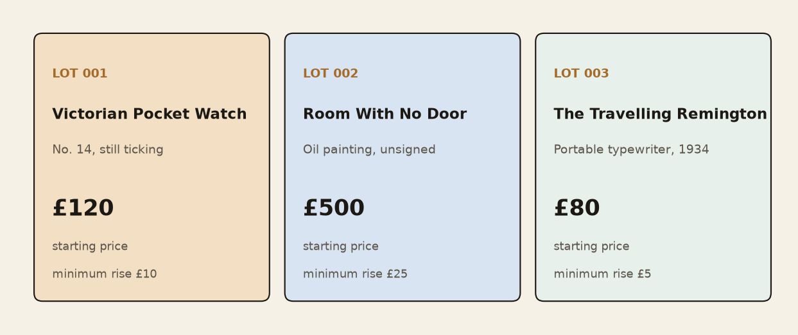

| Lot | Object | Opens at | Minimum rise |
| --- | --- | --- | --- |
| 001 | Victorian Pocket Watch, no. 14, still ticking | £120 | £10 |
| 002 | Room With No Door, oil, unsigned | £500 | £25 |
| 003 | The Travelling Remington, 1934 | £80 | £5 |

The question I want the system to answer is: what happens to the price, and to the losers, when more and more bids hit one lot at the same time?

## What has to stay true

- A bid below the current price plus the minimum rise is rejected.
- A bid that the server received after the deadline is rejected. I use the server time, not the clock on the bidder's laptop.
- Concurrent updates cannot both succeed against the same lot version. The write carries the version I just read. If that version has already moved, the write fails, I read the lot again, and I judge the bid against the new price.
- One lot has one leader and one highest bid.
- Every bid id is remembered. A second delivery of the same message does not raise the price twice.
- Accepted and rejected bids can be read back afterwards.

## How a bid moves

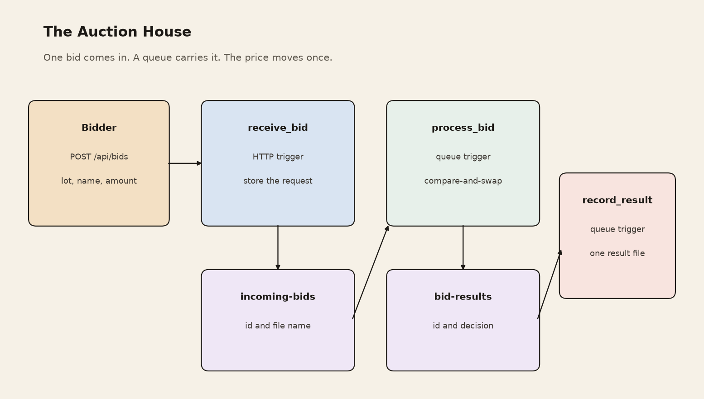

The functions do not call each other. A queue trigger starts the next one [1], [2]. Each queue message is an id and a file name. The bid itself sits in blob storage. The version check is optimistic concurrency [5].

| Place | What is stored |
| --- | --- |
| `auction/requests/<bid_id>.json` | The bid function 1 accepted for checking. |
| Queue `incoming-bids` | The id and the request file name. This starts function 2. |
| `auction/lots/<lot_id>.json` | The price, the leader, the version, and the bids already judged. |
| Queue `bid-results` | The id and the decision file name. This starts function 3. |
| `auction/results/<bid_id>.json` | Accepted or rejected, and why. |

**1. receive_bid.** HTTP, `POST /api/bids`. I send `lot_id`, `bidder`, and `amount`. The function checks the shape, stamps the bid with the server time, writes the request, and queues a pointer. The reply is `Queued bid <id>`. That reply does not mean the bid won.

```json
{
  "lot_id": "001",
  "bidder": "Bob",
  "amount": 180,
  "seen_price": 120
}
```

`seen_price` is the price the bidder thought was current. I use it only to tell two kinds of loss apart: too low from the start, or outbid while the bid was waiting.

**2. process_bid.** Queue trigger on `incoming-bids`. It reads the lot and the etag. If this bid id is already stored on the lot, it keeps that decision and does not change the price. Otherwise it judges the bid and writes the lot back only if the etag still matches. Azure calls that an `If-Match` write [3]. A clash raises `ResourceModifiedError`.

On Azure, one invocation tries that write up to 12 times. Twelve is the deployed limit in `function_app.py`. The laptop model uses a different limit, 80, and a failed bid there is abandoned. On Azure, if all 12 attempts lose, the invocation raises an error. The queue then delivers the message again as a new invocation. A caught clash inside those 12 attempts is not, by itself, a portal error. A portal error is an invocation that raised.

After a successful write, or after finding that this bid id was already applied, the function writes `decisions/<bid_id>.json` and sends a pointer on `bid-results`. If the function crashes after the price write and before that send, the retry finds the stored decision and still sends the pointer. The price is not raised a second time. `record_result` then writes the same result path again.

**3. record_result.** Queue trigger on `bid-results`. It writes `results/<bid_id>.json`. A repeat delivery overwrites that same file. That is at-least-once execution with an idempotent file path, not a proof that the function ran exactly once.

## Why Python

I used Python for the functions and for the program that sends the bids. Azure Functions runs Python 3 as a supported worker, so the same language is deployed and used to generate the workload [4]. The HTTP calls need only the standard library. Matplotlib, on the laptop, draws the figures. I did not need a second language to judge a bid, store JSON, or summarise a batch.

## How the tests were run

Each workload below was run once. I did not repeat a batch and average it.

**Azure.** The app is `auction-house` in Switzerland North. A short Python script on my laptop posted JSON to `POST /api/bids` with `ThreadPoolExecutor`, one worker per bid in the batch. The batches were 1, then 10, then 50, then 100, all on lot 003, and each batch started only after the previous one had finished. The amount was `80 + 5 * ((i % 40) + 1)` pounds, so every bid was at least one minimum rise above the opening price of £80, and the same amounts recur. `seen_price` was 80. The reported time is the client interval from sending the request to reading the HTTP response. It ends when `receive_bid` replies. It is not the time until `results/<bid_id>.json` exists. I did not measure that end-to-end interval.

**Laptop.** `scripts/make_figures.py` uses the same judge and compare-and-swap rules in memory, with up to 32 threads. Seed 7 fixes the amounts: each bid is £120 plus 1 to 40 steps of £10. One case puts every bid on one lot. The other spreads the same bids across 20 lots. Azure only accepts lots 001, 002, and 003, so the 20-lot case was not deployed. A bid that still loses after 80 attempts is marked `gave_up`. The clock is the time until every thread has returned. Because the threads race, a second run can change the clash count. The zeros at 50 and 100 bids on one lot are from this single run. They are not a stable result.

## Three people, one watch

The watch opens at £120. Alice bids £150, Bob bids £180, Charlie bids £160. All three saw £120, and all three would be legal at the opening price.

Taken in that order, Alice is accepted, Bob replaces her, and Charlie is rejected. £160 is no longer enough once the book says £180.

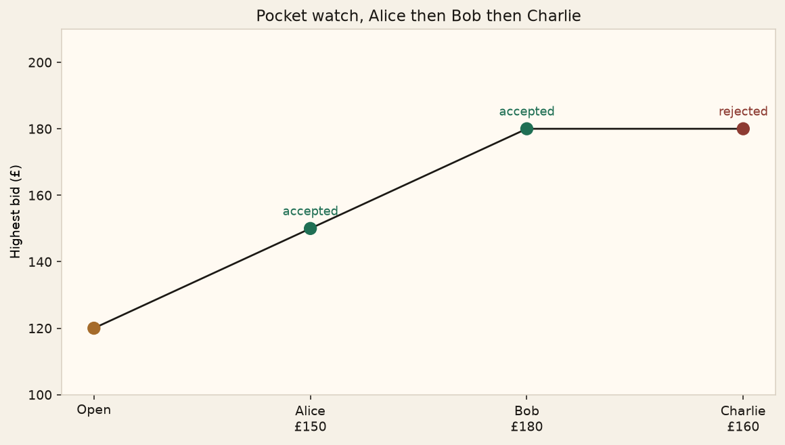

The other order is Charlie, then Alice, then Bob. Charlie is accepted, Alice is rejected, and Bob still finishes as the leader on £180. Who gets a "yes" along the way depends on the order. The final leader does not have to be the person whose HTTP call arrived last.

The full two tables are in [walkthrough/pocket_watch.md](walkthrough/pocket_watch.md). Running Bob's bid a second time leaves the price at £180.

## The last minute

The deadline in these runs is 18:00:00 UTC on 3 November 2026. Mina, Owen, and Priya bid in the last 30 seconds. Sam and Noor bid higher, but the server time is already past 18:00, so they are late. Priya keeps the watch at £310. A larger bid does not win after the deadline.

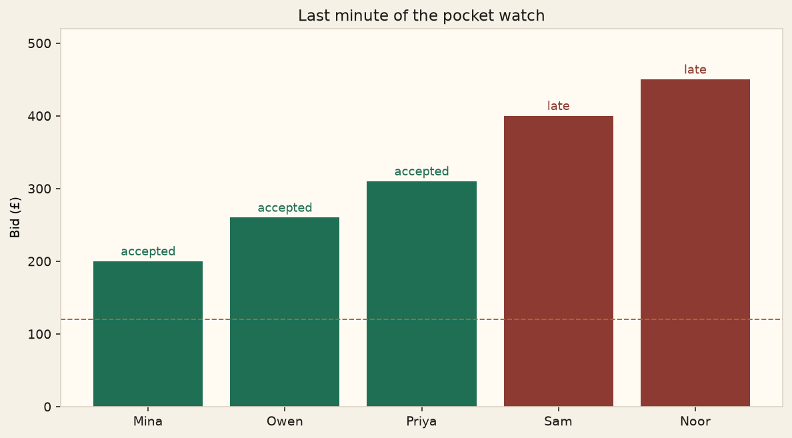

| Bidder | Bid | Server time | Result |
| --- | --- | --- | --- |
| Mina | £200 | 17:59:31 | accepted |
| Owen | £260 | 17:59:44 | accepted |
| Priya | £310 | 17:59:58 | accepted |
| Sam | £400 | 18:00:01 | late |
| Noor | £450 | 18:00:06 | late |

## What Azure did

I deployed the three functions as the app `auction-house` in Switzerland North. The address of `receive_bid` is:

`https://auction-house-b2fjhsc3gneda8cw.switzerlandnorth-01.azurewebsites.net/api/bids`

The deadline on that app is `2026-11-03 18:00:00` UTC. Bids sent on the evening of 2 November were on time.

**One bid on the pocket watch.** Bob bid £180 against the opening price of £120. The HTTP reply was `Queued bid 20261102-215819-687f02c7`. After the queues had run, `lots/001.json` had highest £180, leader Bob, and version 1. `results/20261102-215819-687f02c7.json` says `"reason": "accepted"`. The price he beat was £120, and there was no previous leader.

**Three bids on the painting.** I sent Alice £550, then Bob £650, then Charlie £600. All three had seen £500. The lot file ended at version 3, so each bid was written once.

| Bidder | Bid | Price on the book | Result |
| --- | --- | --- | --- |
| Alice | £550 | £500 | accepted |
| Bob | £650 | £550, leader Alice | accepted |
| Charlie | £600 | £650, leader Bob | outbid |

Charlie's £600 would have been enough at the opening price. It was not enough once Bob was the leader. The final leader is Bob, on £650.

**161 bids on the typewriter.** I posted batches of 1, 10, 50, and 100 bids together, all on lot 003. That is 161 calls to `receive_bid`. Every call returned successfully. The client clock stops at that reply.

| Bids together | Whole batch | Median reply | 95th percentile | Slowest | Failed |
| --- | --- | --- | --- | --- | --- |
| 1 | 2.757 s | 2.756 s | 2.756 s | 2.756 s | 0 |
| 10 | 2.920 s | 2.579 s | 2.901 s | 2.901 s | 0 |
| 50 | 1.193 s | 0.495 s | 0.918 s | 1.181 s | 0 |
| 100 | 1.580 s | 0.723 s | 1.400 s | 1.555 s | 0 |

The first batches took about 3 seconds because the app was idle. After it was warm, the median dropped below a second. At 100 bids together the median was 0.723 seconds and the slowest reply was 1.555 seconds. These times are not the time spent updating the price.

When `process_bid` had finished, `lots/003.json` was at version 161. One version for each bid, so none was lost and none was applied twice. Seven bids were accepted. The price moved £80, £105, £120, £125, £160, £215, £250, £280. The remaining 154 bids were rejected as outbid. The leader is bidder-79 at £280, which is the highest offer in the batch. Another bidder also offered £280 and was rejected, because the minimum rise is £5 and the book already said £280. One stored leader, not two.

Across the three lots the versions are 1, 3, and 161. That is 165 writes, one for each call `receive_bid` accepted.

**What the portal counted.** I opened Invocations for each function after the typewriter batches. The page lists at most 20 rows. Sampling is on for everything except HTTP requests, so the success tiles for the two queue functions are a sample. The final lot versions provide evidence of committed bid-state updates.

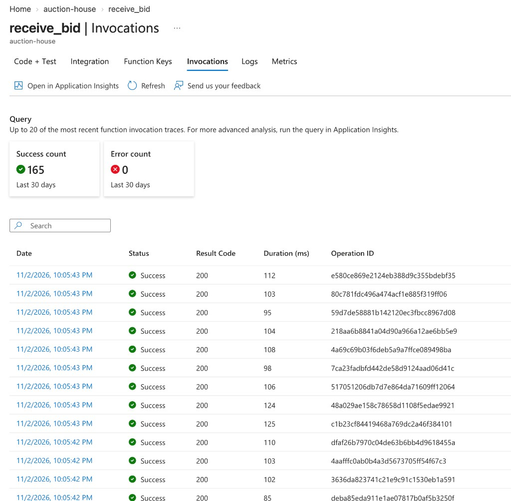

`receive_bid` shows 165 successes and 0 errors. That is Bob, plus Alice, Bob, and Charlie, plus the 161 typewriter bids. The rows on screen are from 10:05 PM, after the app was warm, and the portal duration is about 85–125 ms. The client times in the table above are longer because they include the network and the idle start.

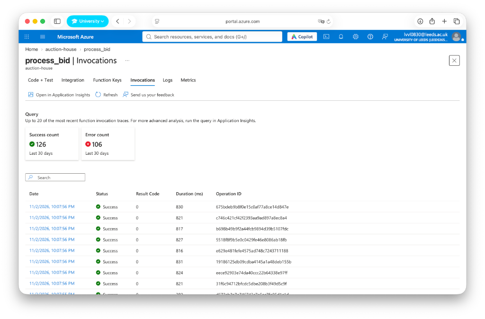

`process_bid` shows 126 successes and 106 errors. I treated that as a possible bug and followed it through.

The portal count for that minute is 232 invocations, which is 126 + 106. I opened five failed traces from 22:07:53 UTC. Each one lasted about 2.7–2.9 seconds and ended in the same place: `RuntimeError: Could not record bid <bid_id>`. That is the line the function raises after 12 lost writes. The storage calls behind it returned `412 ConditionNotMet` on `auction/lots/003.json`. A clash that is caught inside those 12 attempts does not turn the invocation red. The red row is the attempt that used them all up. The traces did not show a failed dependency, and `409 ContainerAlreadyExists` only means the container was already there.

I then checked whether “could not record” meant the bid had disappeared. One of the failed ids, `20261102-220537-837afea0`, is still in `lots/003.json`, recorded as outbid. The queue had delivered the message again, and a later invocation had written the decision. The 106 errors are failed attempts. They are not 106 missing bids. The lot versions, 1 + 3 + 161 = 165, are evidence that 165 bid-state updates were committed. They do not prove that `process_bid` ran exactly once per bid, and they do not prove that every `results/<bid_id>.json` file exists.

The last check was the queue itself. In storage account `auctionhousergac6f` the only queues were `incoming-bids` and `bid-results`. Azure had not created `incoming-bids-poison` or `bid-results-poison`, and `incoming-bids` was empty. A poison queue appears only after a message has failed the dequeue limit, which is five deliveries when the app does not set another limit [2]. No message reached that limit. The failed attempts were retried, and then the messages were removed. The auction result was intact.

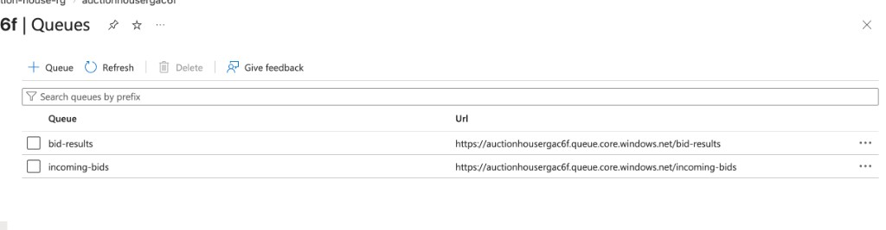

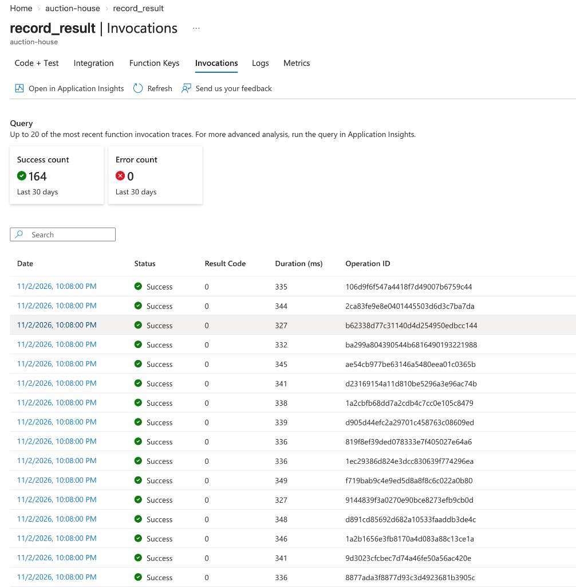

`record_result` shows 164 successes and 0 errors. The visible durations are about 330–350 ms. This tile does not show a failed recording. It is one short of 165, the page is sampled, and I did not count the blobs in `results/`. I do not claim that all 165 result files were written.

## One lot, or twenty, on my laptop

Before the Azure run I tried the same rules with threads on my laptop, so I could see a rush of 1,000 bids. Every bidder had seen £120 and offered at least one minimum rise above it. One run puts every bid on a single lot. The other spreads them across 20 lots. A second run can move the clash count a little, because the threads race. The decision rules do not move. Azure itself only has the three catalogue lots, so the 20-lot case stays on the laptop.

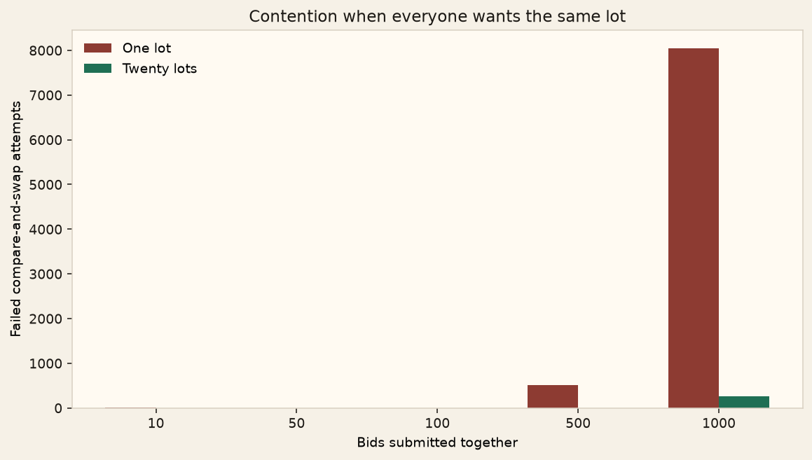

| Bids together | One lot, seconds | One lot, clashes | One lot, gave up | Twenty lots, seconds | Twenty lots, clashes |
| --- | --- | --- | --- | --- | --- |
| 10 | 0.003 | 9 | 0 | 0.001 | 0 |
| 50 | 0.005 | 0 | 0 | 0.002 | 0 |
| 100 | 0.019 | 0 | 0 | 0.004 | 0 |
| 500 | 0.914 | 511 | 0 | 0.030 | 0 |
| 1,000 | 15.072 | 8,052 | 81 | 0.127 | 265 |

On one lot, 1,000 bids took about 15 seconds and 81 bids were abandoned after 80 failed writes. Spread over 20 lots, the same 1,000 bids took about 0.13 seconds, with 265 clashes and no abandoned bids. Contention depends on how many bids target the same shared state, not only on how many bids exist. Optimistic concurrency keeps a single leader, but under that load it also produces repeated reads, failed writes, and abandoned bids. That can raise both latency and the number of executions. The 81 abandoned bids exist because the laptop stops at 80 attempts. The deployed function stops at 12 attempts inside one invocation and then leaves the retry to the queue.

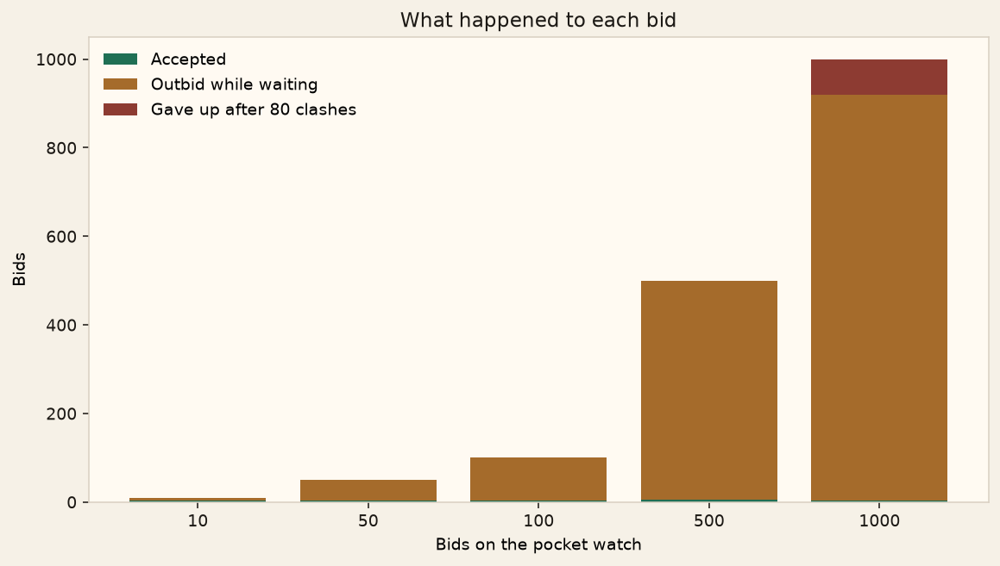

At 1,000 bids on one lot, 3 were accepted, 916 were rejected as outbid, and 81 were abandoned. The stored price still reached the highest offer in the batch, £520. The retry cap is what creates the abandoned bids. Without a cap the model would keep rereading. With a cap, a bid can be dropped so the rest of the run can finish.

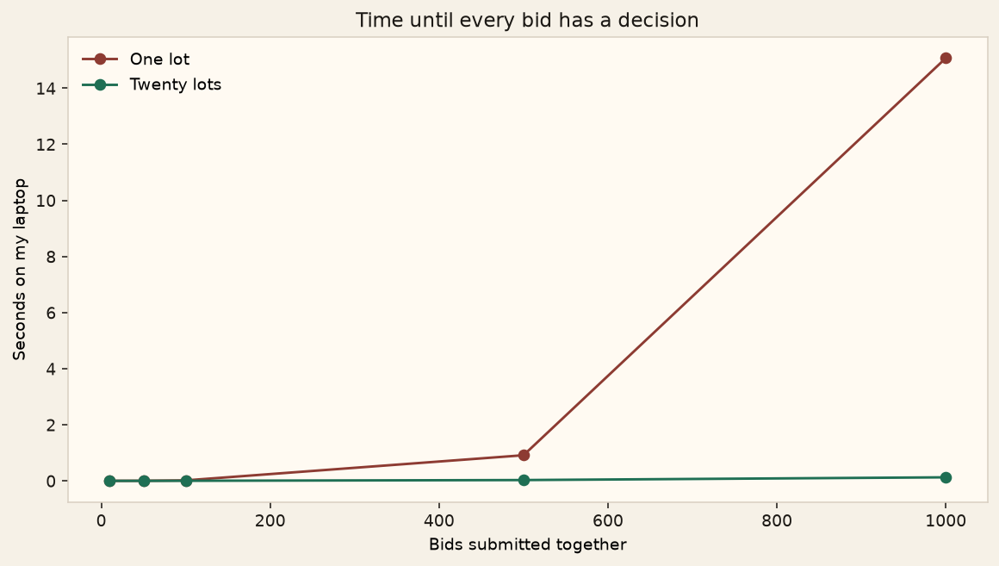

The useful comparison is one popular lot against many quieter lots. A last-second rush on one object is where the version checks, the retries, and the abandoned bids show up.

## What each result shows

| Evidence | What it shows | What it does not show |
| --- | --- | --- |
| 161 Azure HTTP calls, 0 failures | `receive_bid` accepted a rising concurrent load | How long the whole workflow took to finish |
| Lot versions 1, 3, and 161 | 165 bid-state updates were committed, with one leader on each lot | That every function ran exactly once, or that every result file exists |
| 106 failed `process_bid` invocations | Attempts that exhausted 12 writes after `412 ConditionNotMet` on lot 003 | That 106 bids were lost. One failed id is still stored on the lot |
| `record_result`, 164 successes and 0 errors | The third function's sampled runs did not fail | A complete count of `results/` blobs |
| Laptop, 1,000 bids | Contention and the 80-attempt cap in the local model | Azure's behaviour at 1,000 bids |

## Limitations

The lots and the bidders are fictional. The chances in the story are the minimum rises I chose, not prices from a real sale. The largest contention run, 1,000 bids, was on my laptop. Azure was tested up to 100 concurrent HTTP calls, once each. I did not measure the time from sending a bid to the appearance of its result file, so I do not claim a completion-time percentile for the whole workflow. I followed five failed `process_bid` traces and the queues. The five traces showed the same `412` conflict and the same give-up error. I did not read all 106 traces one by one. No poison queue had been created.

## References

[1] Microsoft, "Azure Functions overview." https://learn.microsoft.com/en-us/azure/azure-functions/functions-overview

[2] Microsoft, "Azure Queue storage trigger for Azure Functions." https://learn.microsoft.com/en-us/azure/azure-functions/functions-bindings-storage-queue-trigger

[3] Microsoft, "Managing concurrency in Blob Storage." https://learn.microsoft.com/en-us/azure/storage/blobs/concurrency-manage

[4] Microsoft, "Azure Functions Python developer guide." https://learn.microsoft.com/en-us/azure/azure-functions/functions-reference-python

[5] H. T. Kung and J. T. Robinson, "On optimistic methods for concurrency control," *ACM Transactions on Database Systems*, vol. 6, no. 2, pp. 213–226, 1981.

## Where the files are

```text
auction-house/
├── function_app.py     receive_bid, process_bid, record_result
├── auction.py          the price rules and the compare-and-swap
├── host.json
├── requirements.txt
├── scripts/            the laptop run that drew the pictures
├── figures/            the pictures
├── results/            the tables from that run
└── walkthrough/        Alice, Bob, and Charlie
```

| File | What it is |
| --- | --- |
| [function_app.py](function_app.py) | The three Azure functions. |
| [auction.py](auction.py) | Judging a bid, and the in-memory version check. |
| [scripts/make_figures.py](scripts/make_figures.py) | Runs the batches and writes the pictures. |
| [figures/](figures/) | Lots, workflow, the watch, contention, outcomes, latency, and the three portal screenshots. |
| [results/](results/) | The csv tables behind the pictures. |
| [walkthrough/pocket_watch.md](walkthrough/pocket_watch.md) | The two orders of Alice, Bob, and Charlie. |

The function files stay in this folder so the folder can be deployed as one Function App. The pictures and the scripts are not part of that deploy.

To draw the pictures again I use the laptop environment that has matplotlib:

```bash
python3 scripts/make_figures.py
```
